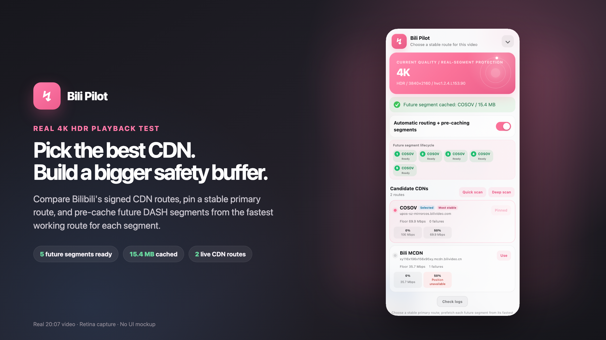
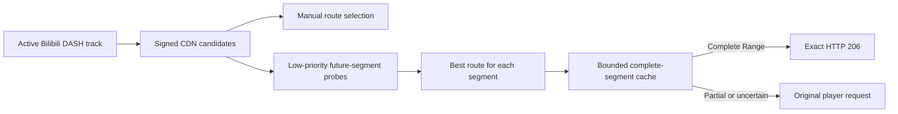

# Bili Pilot

**English** | [Simplified Chinese](README.zh-CN.md)

Bili Pilot is an experimental Chrome extension that helps stabilize high-bitrate Bilibili playback. It compares the signed CDN routes Bilibili already provides, supports manual route selection, and can pre-cache upcoming DASH segments from the best available route for each segment.

> Bili Pilot is an independent community project. It is not affiliated with or endorsed by Bilibili.

## Preview

<p align="center">
  <a href="docs/images/bili-pilot-x-launch.png"></a>
</p>

This launch image uses a Retina capture from a real 4K HDR playback test. It shows Bili Pilot comparing Bilibili-provided CDN routes and caching future DASH segments beyond the player's existing buffer.

## Install

Bili Pilot currently ships as an unpacked Chrome extension. It works on desktop Chrome for macOS, Windows, and Linux. Firefox, Safari, mobile browsers, and the Chrome Web Store are not supported yet.

### From a release package

1. Download the latest `Bili-Pilot-x.y.z.zip` from the repository's [Releases](../../releases/latest) page.
2. Extract the ZIP file. Do not select the ZIP itself in Chrome.
3. Open `chrome://extensions`.
4. Enable **Developer mode** in the top-right corner.
5. Select **Load unpacked**.
6. Select the extracted `bili-pilot` folder containing `manifest.json`.
7. Open or reload a Bilibili video page.

Chrome may show a developer-mode warning after restart because this is not a Chrome Web Store installation. The extension must be reloaded from `chrome://extensions` after updating its files.

### From source

Use GitHub's **Code → Download ZIP** action or clone the repository, then load the repository folder containing `manifest.json` with the same steps above.

There is no build step and no runtime dependency. `npm install` is not required to use the extension.

## Quick start

1. Open a regular `https://www.bilibili.com/video/...` page and start playback.
2. Select a fixed quality such as 1080P60 or 4K so measurements stay on one video representation.
3. Expand the **Bili Pilot** panel and wait for the active quality and CDN candidates to appear.
4. Run **Quick scan** to compare route stability.
5. Either select **Use** to pin a CDN manually, or enable **Automatic routing + pre-cache**.
6. When pre-cache is enabled, let the player build at least 15 seconds of buffer. The panel will show upcoming segments as `Planned`, `Downloading`, `Retrying`, `Ready`, or `Re-probing`.

`Ready` means the complete byte range is in memory and can be delivered to the player. A partial download is never marked ready and is never served as a cache hit.

## Features

- **Manual CDN selection:** pin any signed route supplied for the active video track.
- **Quick and deep scans:** compare conservative floor throughput and failures rather than trusting one peak measurement.
- **PCDN/MCDN-aware ordering:** ordinary official routes are preferred automatically; risk-classified routes remain available for manual choice and last-resort fallback.
- **Per-segment route selection:** different upcoming segments can be downloaded from different CDNs.
- **Adaptive pre-cache:** prepare the next 3–8 real DASH segments according to current buffer headroom.
- **Player-first scheduling:** safe buffered headroom admits one low-priority background transfer; dropping below 15 seconds cancels it. Pausing playback does not discard existing headroom.
- **Fail-open delivery:** cached bytes are returned only for complete Range coverage; every uncertain case uses Bilibili's original request.
- **Local and private:** no account service, remote backend, analytics, or telemetry.
- **Localized UI:** English, Simplified Chinese, and Traditional Chinese follow Chrome's UI language automatically.

## How it works

A general speed test does not measure the path to the CDN serving a particular Bilibili media file. Bilibili may provide multiple signed URLs for one DASH track, and route quality can vary with time and byte position.

Bili Pilot therefore operates on the real active track:

1. Observe Bilibili playurl data and actual media requests to identify the active representation.
2. Preserve every complete signed candidate URL; never fabricate a route by replacing only the hostname.
3. Compare ordinary candidates first. PCDN/MCDN candidates are used automatically only as last-resort recovery.
4. Parse the DASH `sidx`, probe future real segments at low priority, and download each complete segment from its best successful route.
5. Return an exact HTTP 206 response only when cached data covers every requested byte; otherwise pass through unchanged.



For the full reasoning and observed failure model, read [Problem and solution](docs/PROBLEM_AND_SOLUTION.md). For code boundaries and state ownership, read [Architecture](docs/ARCHITECTURE.md).

## Privacy and permissions

Bili Pilot requests only:

- `storage`, for the pre-cache preference and non-sensitive local UI state;
- access to Bilibili pages and known media CDN families used by signed video URLs.

Signed URLs are used only for local Range requests. Bili Pilot does not collect or upload browsing history, cookies, page text, account information, signed media URLs, or playback analytics. It has no background service worker or remote configuration service.

## Troubleshooting

### The panel does not appear

Confirm that the extension is enabled, reload it on `chrome://extensions`, then reload the Bilibili tab.

### The panel keeps waiting for a video

Start playback and wait for a media request. Bili Pilot waits for evidence of the active track instead of guessing from inactive playurl representations.

### No CDN candidates appear

The page may not have exposed a supported DASH playurl yet. Try a regular video page and start playback.

### Every scan times out

All signed routes may be slow or unavailable on the current network. Bili Pilot cannot invent another authorized CDN.

### Pre-cache does not start

Check that pre-cache is enabled, at least 15 seconds are buffered, and the active track exposes a readable `SegmentBase.indexRange` and `sidx`. Playback may be paused; pre-cache is driven by safe buffered headroom rather than the play/pause state.

### A reachable CDN still stalls

A large Range can transfer most bytes quickly and then stop near its tail. The player can hit its deadline even if that URL eventually returns HTTP 206. A successful small probe is useful evidence, not a guarantee that a later full segment will finish on time.

## Limitations

- Bili Pilot can use only the signed candidates returned for the active track. It does not discover arbitrary CDN nodes, bypass account or quality restrictions, or replace a VPN.
- Exact pre-cache requires a readable DASH `sidx`; manual route selection can still work without one.
- Pre-cache is preventive. It cannot guarantee recovery from cold start, seek, or an already empty buffer.
- Live routing depends on Bilibili continuing to load DASH media through page-visible Fetch/XHR.
- Automated tests verify the mechanics, but real benefit should be evaluated with controlled baseline-versus-enabled playback runs on the same video, quality, interval, and network.

## Development

The extension source is plain JavaScript and has no production dependencies. Node.js 18 or newer is needed only for tests.

```bash
npm test
npm run check
```

The suite covers active-track selection, signed routing, PCDN/MCDN classification, Range and `sidx` parsing, probe failure control, player-first scheduling, multi-CDN retry, cache assembly, protocol parity, stable UI rendering, locales, and the Manifest surface.

When editing extension files, reload the extension on `chrome://extensions` and then reload the Bilibili tab so both execution worlds receive the new code.

## Contributing

Issues and focused pull requests are welcome. Please include:

- the video quality and whether the page is a regular video, multi-part video, or collection;
- the candidate hostnames, with signed query values removed;
- the exact UI or network symptom and reproduction steps;
- baseline-versus-enabled evidence for performance claims;
- passing `npm test` and `npm run check` results for code changes.

Do not post complete signed media URLs, cookies, account identifiers, or private browsing data.

## Project documentation

- [Problem and solution](docs/PROBLEM_AND_SOLUTION.md): observed playback failure model, design rationale, and evidence standard
- [Architecture](docs/ARCHITECTURE.md): modules, dependency direction, state ownership, and safety invariants
- [Releasing](docs/RELEASING.md): reproducible package, checksum, tag, and first-release workflow

## License

[MIT](LICENSE) © Bili Pilot contributors
