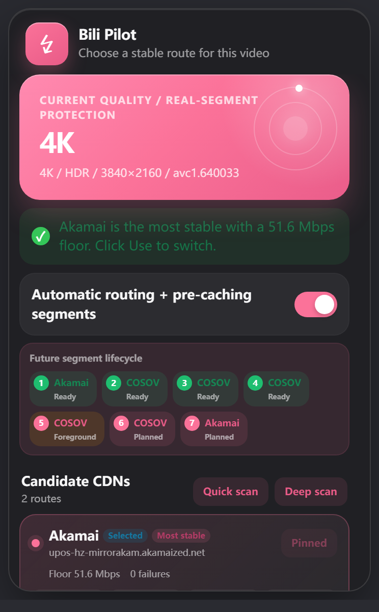
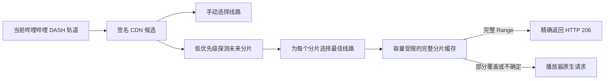

# Bili Pilot

[English](README.md) | **简体中文**

Bili Pilot 是一个实验性的 Chrome 与 Firefox 扩展，用于提升哔哩哔哩高码率视频的播放稳定性。它比较哔哩哔哩已经提供的签名 CDN 线路，支持手动选线，也可以从每个未来 DASH 分片当时表现最好的线路进行预缓存。

> Bili Pilot 是独立的社区项目，与哔哩哔哩没有隶属或官方合作关系。

## 运行预览

<p align="center">
  <a href="docs/images/bili-pilot-popup.png"></a>
</p>

这张宣传图使用真实 4K HDR 播放测试的 Retina 截图，展示 Bili Pilot 比较哔哩哔哩提供的 CDN 线路，并在播放器已有缓冲区之外继续预缓存未来 DASH 分片。

## 安装

Bili Pilot 支持 macOS、Windows 和 Linux 上的桌面版 Chrome 111+ 与 Firefox 140+。暂不支持 Safari、移动浏览器和浏览器扩展商店安装。

### Chrome：使用 Release 安装包

1. 从仓库的 [Releases](../../releases/latest) 页面下载最新的 `Bili-Pilot-Chrome-x.y.z.zip`。
2. 解压 ZIP 文件。不要在 Chrome 中直接选择 ZIP 文件。
3. 打开 `chrome://extensions`。
4. 开启右上角的**开发者模式**。
5. 点击**加载已解压的扩展程序**。
6. 选择解压后的 `bili-pilot` 文件夹；该文件夹中应直接包含 `manifest.json`。
7. 打开或重新加载哔哩哔哩视频页面。

由于当前版本不是通过 Chrome 应用商店安装，Chrome 重启后可能显示开发者模式提示。更新扩展文件后，需要在 `chrome://extensions` 重新加载扩展。

### Chrome：从源码安装

使用 GitHub 的 **Code → Download ZIP** 下载源码，或者克隆仓库，然后按照上面的步骤加载包含 `manifest.json` 的仓库目录。

安装和使用扩展不需要构建，也不需要运行 `npm install`。仓库中的 JavaScript 文件就是扩展本身。

### Firefox：使用签名安装包

1. 从仓库的 [Releases](../../releases/latest) 页面下载 `Bili-Pilot-Firefox-x.y.z.xpi`。
2. 使用 Firefox 打开下载的 XPI，并确认安装。
3. 打开或重新加载哔哩哔哩视频页面。

Firefox 安装包经过 Mozilla 签名。Chrome ZIP 不能作为 Firefox 安装包使用。

### Firefox：临时加载源码

开发者也可以临时加载同一份源码进行测试：

1. 下载或克隆仓库。
2. 使用 Firefox 140 或更新版本打开 `about:debugging#/runtime/this-firefox`。
3. 点击**临时载入附加组件**。
4. 选择仓库根目录中的 `manifest.json`。
5. 打开或重新加载哔哩哔哩视频页面。

Firefox 退出后会移除临时扩展。正常的持久安装需要经过 Mozilla 签名的 XPI。

## 快速开始

1. 打开普通的 `https://www.bilibili.com/video/...` 页面并开始播放。
2. 固定一个画质，例如 1080P60 或 4K，避免测量过程中切换到不同的视频表示。
3. 点击工具栏的 **Bili Pilot** 图标打开弹窗，等待当前画质和 CDN 候选出现。
4. 点击**快速扫描**，比较不同线路的稳定性。
5. 可以点击**使用**手动固定 CDN，也可以开启**自动择优 + 预缓存**。
6. 开启预缓存后，让播放器先积累至少 15 秒缓冲。弹窗会显示未来分片处于`已规划`、`下载中`、`重试中`、`已就绪`或`等待重测`状态。

弹窗只读取内容脚本为当前标签页维护的状态，关闭弹窗不会中断测速、选路和预缓存。

`已就绪`表示完整字节区间已经进入内存，可以交付给播放器。部分下载不会被标记为已就绪，也不会作为缓存命中返回。

## 功能

- **手动选择 CDN：**固定当前视频轨道已经获得签名授权的任意线路。
- **快速与深度扫描：**比较保底吞吐量和失败次数，而不是只相信一次峰值。
- **PCDN/MCDN 风险排序：**自动模式优先普通官方线路；风险线路仍可手动选择，并保留为最终回退。
- **逐分片选线：**相邻的未来分片可以由不同 CDN 下载。
- **自适应预缓存：**根据当前缓冲余量，准备未来 3–8 个真实 DASH 分片。
- **播放优先：**存在安全缓冲时只允许一个低优先级后台传输；缓冲低于 15 秒就立即取消。暂停播放不会浪费已经建立的安全缓冲。
- **安全回退：**只有完整覆盖 Range 时才返回缓存；任何不确定情况都使用哔哩哔哩原生请求。
- **本地与隐私：**没有账户服务、远程后端、分析或遥测。
- **自动本地化：**英文、简体中文和繁体中文会跟随浏览器界面语言自动切换。

## 工作原理

普通测速无法代表当前网络到某个哔哩哔哩媒体 CDN 的真实路径。哔哩哔哩可能为同一条 DASH 轨道提供多个签名地址，而线路质量也可能随时间和文件字节位置变化。

Bili Pilot 因此只围绕真正播放的轨道工作：

1. 观察哔哩哔哩 playurl 数据和真实媒体请求，识别当前视频表示。
2. 保留每一个完整签名候选地址，绝不只替换主机名来拼接线路。
3. 优先比较普通候选；PCDN/MCDN 只作为自动模式下的最终恢复线路。
4. 解析 DASH `sidx`，以低优先级探测真实未来分片，并从每个分片最好的成功线路下载完整内容。
5. 只有缓存覆盖播放器请求的每一个字节时，才精确返回 HTTP 206；否则保持原生请求不变。



完整的问题分析和设计理由参见英文版[问题与解决方案](docs/PROBLEM_AND_SOLUTION.md)。模块边界与状态所有权参见英文版[架构文档](docs/ARCHITECTURE.md)。

## 隐私与权限

Bili Pilot 只申请：

- `storage`，用于保存预缓存开关和不敏感的本地界面状态；
- 哔哩哔哩页面及已知媒体 CDN 家族的访问权限，用于处理已签名的视频地址。

签名地址只用于本地 Range 请求。Bili Pilot 不收集或上传浏览历史、Cookie、页面文字、账户信息、签名媒体地址或播放分析数据，也没有后台 Service Worker 或远程配置服务。

## 故障排查

### 弹窗提示尚未连接

确认扩展已启用，在 `chrome://extensions` 重新加载扩展，然后重新加载哔哩哔哩页面。

### 弹窗一直等待视频

开始播放并等待媒体请求出现。Bili Pilot 会等待当前轨道的真实证据，不会根据未播放的 playurl 表示进行猜测。

### 没有 CDN 候选

页面可能尚未提供受支持的 DASH playurl。请尝试普通视频页面并开始播放。

### 所有扫描都超时

当前网络下所有已签名线路都可能很慢或不可用。Bili Pilot 无法凭空创建另一条授权 CDN。

### 预缓存没有开始

确认预缓存已开启、至少有 15 秒缓冲，并且当前轨道提供可读取的 `SegmentBase.indexRange` 和 `sidx`。视频可以处于暂停状态；预缓存由安全缓冲余量驱动，不依赖播放/暂停状态。

### CDN 可以连接但仍然卡顿

一个大 Range 可能快速传输大部分字节，却在末尾停止。即使该地址最终返回 HTTP 206，播放器也可能已经超过等待期限。成功的小范围探测是有价值的证据，但不能保证之后的完整分片一定按时完成。

## 限制

- Bili Pilot 只能使用当前轨道返回的签名候选。它不会发现任意 CDN 节点、绕过账户或画质权限，也不能代替 VPN。
- 精确预缓存要求 DASH 轨道具有可读取的 `sidx`；没有 `sidx` 时仍可手动选择线路。
- 预缓存是预防机制，无法保证修复冷启动、跳转或缓冲已经耗尽的情况。
- 实时线路切换依赖哔哩哔哩继续通过页面可见的 Fetch/XHR 加载 DASH 媒体。
- 自动化测试验证机制本身；真实收益仍应在同一个视频、画质、区间和网络下进行关闭与启用扩展的受控对比。

## 开发

扩展源码是没有生产依赖的原生 JavaScript。只有运行测试时才需要 Node.js 18 或更高版本。

```bash
npm test
npm run check
```

测试覆盖当前轨道识别、签名线路、PCDN/MCDN 分类、Range 与 `sidx` 解析、探测失败控制、播放优先调度、多 CDN 重试、缓存拼接、协议一致性、稳定界面渲染、语言包和 Manifest 表面。

修改扩展文件后，需要先在 `chrome://extensions` 重新加载扩展，再重新加载哔哩哔哩页面，确保两个执行环境都使用新代码。

## 参与贡献

欢迎提交 Issue 和范围清晰的 Pull Request。请提供：

- 视频画质，以及页面属于普通视频、多 P 视频还是合集；
- 候选主机名，请删除签名查询参数；
- 准确的界面或网络症状，以及可复现步骤；
- 涉及性能提升时，提供关闭与启用扩展的对比证据；
- 修改代码时，附上通过 `npm test` 和 `npm run check` 的结果。

请勿公开完整签名媒体地址、Cookie、账户标识或私人浏览数据。

## 项目文档

- 英文版[问题与解决方案](docs/PROBLEM_AND_SOLUTION.md)：播放失败模型、设计理由和证据标准
- 英文版[架构文档](docs/ARCHITECTURE.md)：模块、依赖方向、状态所有权和安全约束
- 英文版[发布流程](docs/RELEASING.md)：可复现安装包、校验和、版本标签与首次发布流程

## 许可证

[MIT](LICENSE) © Bili Pilot contributors
