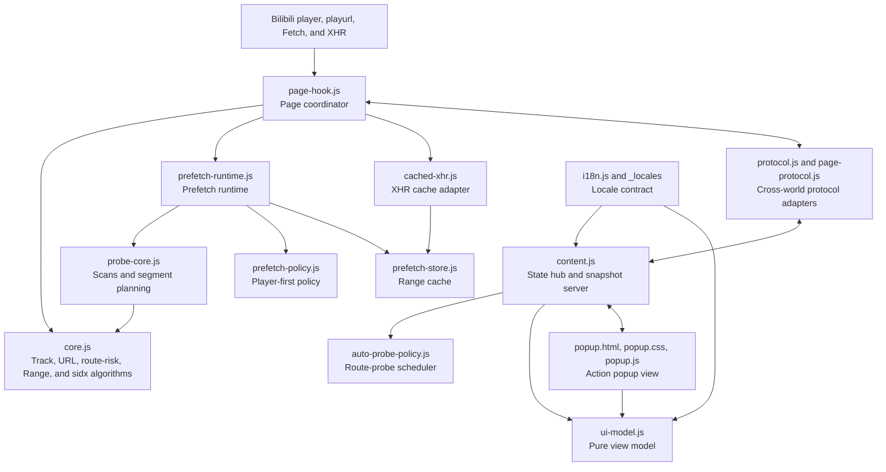

# Bili Pilot Architecture

## Design goals

The extension has two responsibilities:

1. choose among the CDN URLs Bilibili already authorized for the active video track;
2. pre-cache real future DASH segments without competing with the primary player.

The architecture follows three constraints:

- **One-way dependencies:** page coordination may call pure algorithm modules; pure modules must not read the DOM or player state.
- **One state owner:** route plans, prefetch work, cached bytes, and UI state each have one authoritative owner.
- **Fail open:** uncertainty always falls through to the original Bilibili request. The extension never returns partial cache data or fabricates a media URL.

## Layers and dependencies

## Module responsibilities

| Module | Owns | Explicitly does not own |
| --- | --- | --- |
| `protocol.js` | Message names, channel, storage keys, validation, and posting in the isolated world | Routing decisions, page state, UI |
| `page-protocol.js` | Equivalent protocol adapter in the main world | Request rewriting or business state; tests lock it to `protocol.js` |
| `i18n.js` and `_locales/` | WebExtension UI-language detection, message substitutions, English fallback, and localized manifest metadata | Routing, media state, or DOM ownership |
| `core.js` | playurl/DASH parsing, active-track identification, complete signed URLs, pure route-risk classification, Range math, `sidx` parsing, route scoring | Network requests, DOM, runtime state |
| `probe-core.js` | Quick/deep scans, `sidx` reads, per-segment CDN comparison | Prefetch admission or cached bytes |
| `auto-probe-policy.js` | Pure initial, periodic, and playback-recovery probe scheduling with exponential backoff | Route scoring, network requests, or UI |
| `prefetch-policy.js` | Pure prefetch admission based only on buffer headroom | Downloads, timers, page events, request ownership, or route switching |
| `prefetch-store.js` | Segment lifecycle, ranked candidates, completion promises, memory limit, expiry, window reconciliation, mixed-CDN Range assembly | Network requests or player monitoring |
| `prefetch-runtime.js` | Prefetch window, queue, arbitrary-length ranked CDN retry, re-probe backoff, foreground promotion, and download lifecycle | Track discovery, Fetch/XHR rewriting, UI rendering |
| `cached-xhr.js` | Browser-compatible XHR delivery for a ready Range or a promoted in-flight Range | Cache planning and policy |
| `page-hook.js` | playurl/resource observation, active track, Fetch/XHR installation, routing, runtime coordination | Prefetch queue internals or UI view models |
| `ui-model.js` | Speed, error, and quality formatting; stable keyed CDN-row models | DOM, WebExtension APIs, page communication |
| `content.js` | State ownership, scan scheduling and interaction, automatic scan triggers, playback monitoring, a bounded in-memory activity view, and snapshot delivery to the popup | Page DOM, media request interception, cached media bytes, persistent logs, or low-level network debugging |
| `popup.js` | Rendering snapshots into the action popup, local view state such as the open log dialog, and translating clicks into commands | Business state, routing decisions, or anything that must survive the popup closing |

## Three execution contexts

Manifest V3 installs code into two isolated environments, and the toolbar popup adds a third, short-lived one:

- The `MAIN` world shares Bilibili's JavaScript environment and can observe `window.__playinfo__`, Fetch, XHR, and media events.
- The `ISOLATED` world owns the extension's state and can use WebExtension storage without exposing its variables to page scripts. It is the only place where decisions live, and it is bound to the tab, not to the popup.
- The action popup (`popup.html`) is a view that exists only while it is open. It reads snapshots over a `runtime` port and sends commands back, so closing it destroys nothing but the view itself.

The popup exists because an always-mounted in-page panel covered page UI. `content.js` therefore injects nothing into the page any more.

The worlds communicate only through one same-origin `window.postMessage` contract. Chromium can deduplicate the same content-script resource across execution worlds, so the main world loads `page-protocol.js` and the isolated world loads `protocol.js`. Firefox wraps the page window differently in each world, so protocol validation uses the origin, private channel, and known event type instead of JavaScript object identity. `protocol.test.mjs` verifies that the adapters remain compatible. Business modules must not duplicate these protocol strings.

The popup port is a second, independent contract: `chrome.tabs.connect(tabId, { name: "bili-pilot-popup" })` carrying `BILI_CDN_PILOT_POPUP_V1` messages. The content script pushes snapshots (throttled, and only while at least one popup is connected); the popup pushes commands. Snapshots carry a trimmed plan without signed URLs, so the view never holds credentials it does not need.

## Primary data flows

### Track discovery and manual routing

1. `page-hook` observes `__playinfo__`, playurl Fetch/XHR responses, and media resources already requested.
2. `core` uses decoded dimensions and real `.m4s` requests to identify the active video track.
3. `core` creates a route plan containing the complete signed candidate URLs and non-destructive PCDN/MCDN risk metadata for that track.
4. `page-hook` sends the plan to `content` through the shared protocol.
5. A user selection returns through the protocol: the popup sends a command over its port, `content` forwards the choice, and `page-hook` rewrites only later cache-miss media requests.
6. `content` broadcasts a trimmed snapshot to any connected popup, so the view always reflects the tab's current state and can be closed and reopened at any time.

### Adaptive future-segment pre-cache

1. `page-hook` reports player-requested Ranges to `prefetch-runtime`.
2. `prefetch-policy` checks only buffer headroom. It deliberately ignores play, pause, readiness, underflow, and player-request state so native long-running Range requests cannot starve prefetch.
3. `probe-core` parses `sidx` and finds 3–8 real segments beyond the latest observed player frontier.
4. Every future segment independently compares ordinary signed CDN candidates with a small bounded Range. PCDN/MCDN candidates are probed only after all ordinary candidates fail and otherwise remain last-resort complete-download fallbacks.
5. `prefetch-runtime` downloads the complete segment from that segment's fastest candidate and walks the full ranked candidate list on failure.
6. If every ranked candidate fails, stale probe evidence is invalidated and the entry moves through bounded backoff to a fresh all-CDN probe.
7. If the player requests a Range already covered by queued or in-flight entries, those entries become foreground work and their existing completion Promise is reused. Unrelated prefetch work is cancelled.
8. `prefetch-store` saves the bytes with their absolute Range.
9. Fetch/XHR adapters return an exact HTTP 206 only when ready cached data completely covers the player's request. One missing byte or an exhausted promoted task causes one ordinary network pass-through.

## State ownership

- Active track, signed candidates, manual preference, and CDN cooldown: `page-hook`.
- Automatic route-probe cadence and recovery backoff: `auto-probe-policy`.
- Prefetch queue, timers, concurrency, ranked retry, re-probe scheduling, and request ownership diagnostics: `prefetch-runtime`.
- Segment bytes, lifecycle, completion Promise, candidate ranking, TTL, and total memory: `prefetch-store`.
- Scans, results, messages, activity log, prefetch snapshot, and every other view-model input: `content`.
- Popup rendering and transient view state (for example whether the log dialog is open): `popup.js`, discarded when the popup closes.
- DOM node identity: the keyed patch renderer in `popup.js`; after the initial mount, re-rendering the whole popup on every snapshot is forbidden. The page itself is never modified.

## Safety invariants

1. Use only complete signed URLs Bilibili returned for the same track; never replace only the hostname.
2. A manual route selection affects future requests and never aborts an in-flight player request.
3. Prefetch admission depends only on buffered headroom: below 15 seconds cancels background work; at or above 15 seconds permits one low-priority transfer even while Bilibili keeps another Range in flight. Pause, waiting, and stalled events only re-evaluate this policy. Seeking cancels stale work because it changes the segment frontier. Work covering a requested Range is promoted to foreground and reused.
4. Prefetch concurrency is 1. One segment is limited to 32 MB, total ready cache to 96 MB, and TTL to five minutes.
5. Fetch/XHR must use the original network request unless cache data completely covers the requested Range.
6. A video or track change clears the previous route plan, queue, and cache.
7. The popup patches existing keyed nodes and must not rebuild the document on every snapshot. It is the only place that renders UI, and it never injects elements into the page.
8. Candidate handling is list-based. No module may assume exactly two CDNs or encode primary-versus-backup branching for segment retries.
9. Request accounting is cause-aware. Player timeout, network error, HTTP error, extension cancellation, and successful completion are distinct. Extension cancellation must never cool down or penalize a CDN.
10. A player cache lookup is observational. It must not be counted or displayed as a background prefetch request unless the prefetch runtime actually starts network work.

## Test boundaries

- `core.test.mjs`: tracks, URLs, Ranges, `sidx`, and route decisions.
- `probe.test.mjs`: sequential scans, failure control, and per-segment selection.
- `prefetch-policy.test.mjs`: player-first admission rules.
- `auto-probe-policy.test.mjs`: initial and periodic probes, anomaly recovery, coalescing, and exponential backoff.
- `prefetch-runtime.test.mjs`: request priority, paused-buffer admission, ranked retry, and promotion lifecycle.
- `prefetch-store.test.mjs`: cache windows and mixed-CDN Range assembly.
- `cached-xhr.test.mjs`: cached delivery and ordinary-network XHR behavior.
- `protocol.test.mjs`: cross-world messages, storage contract, and adapter parity.
- `ui-model.test.mjs`: stable row models and display formatting.
- `i18n.test.mjs`: locale parity, placeholder parity, runtime locale selection, and translation-key coverage.
- `no-han.test.mjs`: Han characters remain confined to Chinese locale and documentation files.
- `smoke.mjs`: manifest order, permission boundary, module responsibilities, popup markup contract, and forbidden regressions.
- `tests/ui-preview.html`: not a test but a mock harness that renders the popup against fake `chrome.tabs` and `chrome.i18n`, used for layout checks and screenshots.
